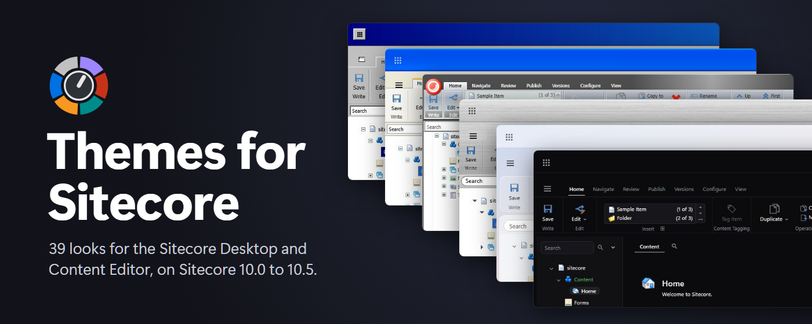

# Themes for Sitecore

A browser extension that re-themes the Sitecore 10.0 to 10.5 Content Management UIs, from the Sitecore Desktop to Launchpad. It works in Chrome, Edge and Firefox.



<!-- themes -->
| Theme | What it looks like |
|---|---|
| Native | Sitecore's own look |
| Debrightify | Sitecore's own layout in a dark, low-glare palette |
| Sitecore 10.4 | The look of Sitecore 10.4 |
| Sitecore 10.5 | The look of Sitecore 10.5 |
| Copenhagen | The classic look of Sitecore 6 and 7 |
| **Everyday** | |
| Beacon | High contrast for low vision and bright rooms, follows your light or dark setting |
| Fjord | A calm Nordic palette, follows your light or dark setting |
| Guardrail | Shows which environment you're on, follows your light or dark setting |
| Compact | Sitecore's own colours at laptop density: shorter rows, a slimmer ribbon, labels beside fields |
| Focus | Quiet warm greys for long editing sessions: the chrome steps back, the field you edit stands out |
| Solar | Warm cream by day and deep teal by night, with the same eight accents in both; follows your light or dark setting |
| Spectrum | Colour-blind safe: states carry a shape as well as a colour; follows your light or dark setting |
| **Modern** | |
| Cupertino | Frosted sidebars, soft shadows, rounded controls and a blue pill selection, follows your light or dark setting |
| Sun Valley | Translucent panels, rounded corners, accent underlines and a centred taskbar, follows your light or dark setting |
| Graphite | A near-black workspace of hairline layers with one violet accent |
| Mountain View | Tonal surfaces, pill indicators and rounded cards, follows your light or dark setting |
| Plasma | Flat grey windows, centred titles and a sky-blue accent, follows your light or dark setting |
| Tahoe | Frosted glass panels over a wallpaper, pill tabs and buttons, follows your light or dark setting |
| **Retro** | |
| Redmond 3.11 | An early-90s desktop of black-outlined grey bevels, navy title bars and small bitmap-style text |
| Chicago | Mid-90s grey windows with two-pixel bevels and gradient title bars over a teal desktop |
| Whistler | Glossy rounded title bars, a beige window face and orange-topped tabs, in four colour schemes |
| Sonata | Platinum greys with pinstriped title bars, bevelled window boxes and lavender highlights |
| Menlo | Light grey panels, a yellow tab for each window's title and a task menu in the top-right corner |
| Redwood | Black title bars, sharp grey bevels inside black outlines and a Dock down the right-hand side |
| Los Gatos | Four colours, blue, white, black and orange: striped title bars and two-pixel white frames |
| Metal Steel | Cool steel greys, periwinkle title bars textured with bumps, flush 3D borders and slanted tabs |
| Cheetah | Pinstripes, brushed metal, blue gel buttons and traffic-light window controls, with a Dock |
| Longhorn | Tinted glass captions with a sheen, glossy buttons and a black taskbar with a round orb |
| Santa Clara | Chunky sand bevels, maroon window frames and a front panel of workspace buttons |
| Warp | Grey bevelled windows, blue title bars, a control bar along the top and notebook tabs |
| **Creative** | |
| Blueprint | A technical drawing in white on cyanotype blue |
| Notebook | Graph paper, pen and sticky notes |
| Meridian | Dawn, day, dusk and night palettes that follow your clock |
| Phosphor | A green-screen terminal |
| Miami | Synthwave neon over a sunset grid |
| Bridge | A starship console of elbows and pills |
| Dessau | Primary colours, black rules and simple shapes |
| Hometown | A late-nineties personal homepage, stars, bevels and all |
| Pocket | A four-shade handheld screen with chunky pixels |
| Riso | A two-ink risograph print in fluorescent pink and teal |
<!-- /themes -->

The themes cover the Content Editor, the Desktop, Sheer UI dialogs, SPE (ISE, Read-Variable dialogs, Show-ListView), Launchpad, SPEAK applications and the login screen. Website content in the Experience Editor is never touched.

## Install for testing

Download the files from the latest release.

### Chrome and Edge

1. Unzip `themes-for-sitecore-<version>-chrome.zip` into a folder you keep.
2. Open `chrome://extensions` (or `edge://extensions`).
3. Turn on **Developer mode**.
4. Click **Load unpacked** and pick the unzipped folder.

Sideloaded builds don't update themselves. To update, unzip the new release over the same folder and click the reload icon on the extension's card.

### Firefox

Open `themes-for-sitecore-<version>-firefox.xpi` in Firefox and confirm the install. The file is signed by Mozilla and updates itself.

## Use

1. Open any Sitecore page, click the **Themes for Sitecore** toolbar icon, and choose **Enable on this site**. The browser asks you to allow that one site.
2. Pick a theme for this site. Each site keeps its own; a site you have not set stays Native.
3. The Identity Server login page is a separate site. Enable it the same way to theme the login screen.

**Disable on this site** removes the extension's access to that site. Reload its tabs to get Sitecore's own look back.

## Make your own theme

There are two kinds: a **built-in theme**, a folder in this repository that ships with the extension and the
Sitecore module, and an **imported theme**, one CSS file you load into your own browser.

### A built-in theme

Each theme is one folder, `extension/themes/<id>/`; adding one touches nothing outside it.
[extension/themes/README.md](extension/themes/README.md) describes its files and [CONTRIBUTING.md](CONTRIBUTING.md)
the checks before a pull request.

With [Claude Code](https://claude.com/claude-code), use the skills in `.claude/skills/`:

- **`sct-new-theme`** builds or reworks a theme, from the design to every surface on Sitecore 10.4 and 10.5. Ask
  for a theme (for example "add a theme inspired by ...") and it takes over; its `pitfalls.md` holds every
  correction earlier themes needed.
- **`sct-verify`** checks a change on the live installs, frame by frame, before it's called done.

Both need local Sitecore installs named in `sitecore.local.json` (see CONTRIBUTING.md).

### An imported theme

An imported theme is one CSS file that starts with a metadata comment:

```css
/* @sct-theme
id: my-theme
name: My theme
versions: 10.4, 10.5
usesTokens: true
*/
html[data-sct-theme="import:my-theme"] {
  --sct-app-bg: #102030;
  --sct-app-fg: #e0e8f0;
  /* ...every role listed in extension/surfaces/tokens.json */
}
```

- With `usesTokens: true` the extension applies its map of Sitecore's UI first, so the file only needs to set the `--sct-*` colour roles from [extension/surfaces/tokens.json](extension/surfaces/tokens.json). Without it, the file styles Sitecore directly.
- Every page the extension themes has `data-sct-theme`, `data-sct-surface` (`shell`, `launchpad`, `login`, `ee`, `speak`) and `data-sct-version` on `<html>`. Scope rules with them.
- Import the file from the popup's settings (the gear): drop it on **Imported themes** or choose it there. Importing a file with the same id again replaces the theme.
- Imported themes may not load anything from other servers. `@import`, remote `url()`s and `@font-face` sources, custom functions and backslash escapes in values are rejected. `data:` URLs and URLs on the Sitecore host are fine.

## Develop

```bash
npm install
npm test
npx playwright test --project=fixtures
npm run build
npm run lint
```

- `extension/` is the extension itself; load it unpacked while developing.
- `tools/gen-area-map.mjs` regenerates `extension/surfaces/*.gen.css` from the stylesheets of local Sitecore installs.
- `tools/css-diff.mjs` produces the candidate CSS behind the Sitecore 10.4 theme.
- `tools/build-workgroups-css.cjs` writes the Redmond 3.11 shell stylesheet.
- `tools/build-metal-css.cjs` writes the Metal Steel shell stylesheet.
- When `extension/` itself is loaded unpacked, a script on an enabled Sitecore page can `window.postMessage({ type: "sct-dev-reload" })` to reload the extension, or `{ type: "sct-dev-set", values: { overrides: { [origin]: themeId } } }` to switch themes. Messages from other windows are ignored, and `npm run build` switches these hooks off in every package.

To contribute a theme or a fix, see [CONTRIBUTING.md](CONTRIBUTING.md). Report vulnerabilities privately, as
[SECURITY.md](SECURITY.md) describes.

### Signing for Firefox testers

Set `config.updateBase` in `package.json` to the release download URL, then:

```bash
WEB_EXT_API_KEY=... WEB_EXT_API_SECRET=... npm run sign:firefox
```

Upload the signed `.xpi` and `dist/updates.json` to the release.

## Known limits

- Some Sitecore installs send a Content-Security-Policy whose `img-src` doesn't allow `data:` images. Theme CSS obeys the page's CSP. On such hosts, glyphs drawn as inline SVG (section arrows, Redmond 3.11 window buttons and scrollbar arrows, the light search magnifier) fall back to Sitecore's own or show plain. Tree expanders and every Metal Steel glyph are drawn with CSS gradients and always work.
- Firefox can't style scrollbar arrows, so Redmond 3.11 and Metal Steel scrollbars there are flat grey.

## Privacy

The extension collects no data. It only talks to the Sitecore hosts you enable (to read `sitecore.version.xml`). It has no access to a site until you enable it there.

## License

Apache License 2.0, see [LICENSE](LICENSE). [NOTICE](NOTICE) lists the third-party material the license does not cover:
the CSS in the Sitecore 6.6, 10.4 and 10.5 themes that is derived from Sitecore's own stylesheets. New themes are welcome;
contributions are licensed under the same terms.

Sitecore is a trademark of Sitecore Corporation A/S. Windows is a trademark of Microsoft Corporation, macOS is a trademark of Apple Inc., and Java is a trademark of Oracle and/or its affiliates. This project is not affiliated with any of them.
