# Accessibility

Themes for Sitecore carries a set of accessibility aids for the Sitecore Content Management UIs: fixes for what
Sitecore tells a screen reader, keys Sitecore lacks, and changes to what is on screen for low vision, colour vision,
reading and motion. They work under every theme, Native included, and change nothing on the server: each one is
undone the moment it is switched off.

This page describes every aid: what it is for, what changes on screen, what a screen reader is given, and how to use
it. Each has a picture of the Sitecore 10.4 Content Editor in its own look (Native) with the aid off and on, or, for an
aid that changes nothing you can see, the markup a screen reader reads.

## Switching them on

Open the extension's popup, then **Settings** and the **Accessibility** tab (with the Sitecore module, its theme
picker has the same tab).

- **Needs.** Tick the ones that fit you: Screen reader, Keyboard, Low vision, Colour vision, Reading and focus,
  Motion. Each switches on the aids that serve it. Point at a need to see what it changes.
- **Fine-tune.** Every aid on its own switch, grouped under the need it serves first. Your choice there wins over the
  needs'.
- **Always on.** The aids that change nothing anyone sees (frame names, role repair, names, landmarks, page language,
  High Contrast) run on every site, under every theme and Native, unless you switch them off.
- **Font, Spacing and Colour filter** sit above the aids on the same tab.

Changes that help anyone, whatever their needs (the item's info and path, Back and Forward, a sizeable image preview,
the command palette, F1's list of shortcuts and more), are on their own tab, **UI improvements**, described in
[docs/ui-improvements.md](ui-improvements.md).

Every setting is per site, and each browser keeps its own.

## Contents

- [Screen reader](#screen-reader): [Frame names](#frame-names), [Role repair](#role-repair), [Names](#names),
  [Landmarks](#landmarks), [Page language](#page-language), [Announcements](#announcements),
  [Field help and errors](#field-help-and-errors)
- [Keyboard](#keyboard): [Focus ring](#focus-ring), [Ribbon toolbar](#ribbon-toolbar),
  [Menu focus](#menu-focus), [Dialogs](#dialogs), [Skip links and F6](#skip-links-and-f6),
  [Tab stops](#tab-stops), [Bigger targets](#bigger-targets)
- [Low vision](#low-vision): [High Contrast](#high-contrast),
  [Atkinson Hyperlegible](#atkinson-hyperlegible)
- [Colour vision](#colour-vision): [Errors in words](#errors-in-words), [Errors in shapes](#errors-in-shapes),
  [Colour filter](#colour-filter)
- [Reading and focus](#reading-and-focus): [Focus mode](#focus-mode),
  [Reading guide](#reading-guide), [OpenDyslexic](#opendyslexic),
  [Wide spacing](#wide-spacing)
- [Motion](#motion): [Reduced motion](#reduced-motion)

## Screen reader

### Frame names
<!-- aid:frame-titles c71ba44545 -->

**What it is for.** The Content Editor, its dialogs and the Desktop are built from frames, and Sitecore names almost
none of them, so a screen reader announces "frame" and nothing else as you move between them.

**What changes.** Nothing you can see. Each frame gets a `title` from the page it shows ("Content Editor", "Rich text
editor", a Sheer UI dialog by its control name), read from the frame's address only. A title Sitecore or your project
already set is left alone, and a website's own frames (the Experience Editor shows your site) are never touched.

**What a screen reader says.** "Content Editor, frame" instead of "frame"; the frame list (Insert+F7 in NVDA, the
rotor in VoiceOver) names each one.

<!-- shots:frame-titles -->
**Need:** Screen reader · **On:** by default, under every theme and Native · **Where:** every page

**Off**

```text
<iframe src="EditorWindow.aspx">
<iframe src="Media Folder.aspx">
<iframe src="7992E405A9BA49E08C87C88060756731.ashx">
<iframe src="Sitecore.Shell.Applications.Security.SecurityDetails.aspx">
<iframe src="JqueryModalDialogs.html">
```

**On**

```text
<iframe src="EditorWindow.aspx" title="Rich text editor">
<iframe src="Media Folder.aspx" title="Sitecore: Media Folder">
<iframe src="7992E405A9BA49E08C87C88060756731.ashx" title="Sitecore: 7992E405A9BA49E08C87C88060756731">
<iframe src="Sitecore.Shell.Applications.Security.SecurityDetails.aspx" title="Security details">
<iframe src="JqueryModalDialogs.html" title="Dialog">
```
<!-- /shots:frame-titles -->

### Role repair
<!-- aid:aria-repair 312ca20090 -->

**What it is for.** Sitecore marks some of its widgets with the wrong roles. Its content tree nodes are links with
`role="group"`, which allows neither "selected" nor "expanded"; its ribbon's tab list also holds the whole toolbar;
and icons that are buttons say `alt=""`, "decorative".

**What changes.** Nothing you can see. Tree nodes become tree items and each list of children a group, so a screen
reader reads the tree as a tree, with each node's level, whether it is open, and which one is selected. The ribbon
becomes a named region with its tab buttons as the tab list. An icon button with an empty `alt` takes the text of its
label or title.

**What a screen reader says.** "sitecore, tree item, expanded, level 1" instead of "sitecore, link".

<!-- shots:aria-repair -->
**Need:** Screen reader · **On:** by default, under every theme and Native · **Where:** the Desktop and Content Editor

**Off**

```text
- tree "Content tree":
  - group "This is the root of the Sitecore content tree.":
    - img "This is the root of the Sitecore content tree."
    - text: sitecore
  - group "This section contains all web site content.":
    - img "This section contains all web site content."
    - text: Content
  - group: Tenant
  - group "The Home item is the default starting point for a website.":
    - img "The Home item is the default starting point for a website."
```

**On**

```text
- tree "Content tree":
  - treeitem "This is the root of the Sitecore content tree.sitecore" [expanded]:
    - img "This is the root of the Sitecore content tree."
    - text: sitecore
  - group:
    - treeitem "This section contains all web site content.Content" [expanded]:
      - img "This section contains all web site content."
      - text: Content
    - group:
      - treeitem "Tenant"
```
<!-- /shots:aria-repair -->

### Names
<!-- aid:names 36f02ea7b6 -->

**What it is for.** Many of Sitecore's controls draw only an icon: the Sitecore logo that leads to the Launchpad,
the ribbon's scroll and "more options" arrows, the new search tab, drop-down arrows. Without a name a screen reader
says "button" or reads the image's file name. Some parts Sitecore makes clickable with a mouse handler alone, which
the keyboard cannot reach.

**What changes.** Nothing you can see. Each icon-only control gets a name ("Launchpad", "More options", "New
search"), and the Desktop's logo, which Sitecore calls "Desktop" though it opens the Launchpad, is named
"Launchpad"; Quick Info's read-only boxes are named by their captions ("Item ID", "Item path"); images get an `alt`
from their title, or an empty one where they only decorate text beside them; a small clickable part with no role
becomes a button you can reach with Tab and press with Enter or Space (except the content tree's gutter icons, which
would add a stop beside every item); and Sitecore's own buttons that answer no key, such as Start, answer Enter and
Space.

**What a screen reader says.** "More options, button" instead of "blank.gif, image"; "Item path, edit, read only,
/sitecore/content/Home".

<!-- shots:names -->
**Need:** Screen reader and Keyboard · **On:** by default, under every theme and Native · **Where:** the Desktop and Content Editor, SPEAK apps, the Launchpad, /sitecore/admin and the login pages

**Off**

```text
<a id="BTAddNewSearch" class="scRibbonEditorTabNormal">
<input class="scEditorHeaderQuickInfoInput">
<input class="scEditorHeaderQuickInfoInput">
<input class="scEditorHeaderQuickInfoInputID">
<input class="scEditorHeaderQuickInfoInputID">
```

**On**

```text
<a id="BTAddNewSearch" class="scRibbonEditorTabNormal" aria-label="New search">
<input class="scEditorHeaderQuickInfoInput" aria-label="Item ID">
<input class="scEditorHeaderQuickInfoInput" aria-label="Item path">
<input class="scEditorHeaderQuickInfoInputID" aria-label="Template">
<input class="scEditorHeaderQuickInfoInputID" aria-label="Item owner">
```
<!-- /shots:names -->

### Landmarks
<!-- aid:landmarks 8f5ff799c7 -->

**What it is for.** Landmarks let a screen reader list the main parts of a page and jump straight to one. Sitecore
marks none.

**What changes.** Nothing you can see. In the Content Editor the tree becomes the "Content tree" navigation and the
editor the "Item editor" main area; the Desktop and its taskbar, the Launchpad, the admin pages and the SPEAK apps'
quick bar get theirs. Only elements with no role of their own are marked.

**What a screen reader says.** The landmarks list (Insert+F7 in NVDA, D to jump) offers "Content tree, navigation"
and "Item editor, main".

<!-- shots:landmarks -->
**Need:** Screen reader · **On:** by default, under every theme and Native · **Where:** the Desktop and Content Editor, SPEAK apps, the Launchpad and /sitecore/admin

**Off**

```text
<div id="ContentTreePanel">
<div id="ContentEditor">
```

**On**

```text
<div id="ContentTreePanel" role="navigation" aria-label="Content tree">
<div id="ContentEditor" role="main" aria-label="Item editor">
```
<!-- /shots:landmarks -->

### Page language
<!-- aid:lang ab3b5435b1 -->

**What it is for.** A page that does not say its language is read in the screen reader's default voice, which
mangles every word when your Sitecore runs in another language.

**What changes.** Nothing you can see. `<html lang>` is set from Sitecore's own UI language (its `shell#lang`
cookie, the `sc_lang` parameter, or the form's `lang_` class). A page that already says its language keeps it.

**What a screen reader says.** The page in the right voice and pronunciation: Danish in a Danish voice.

<!-- shots:lang -->
**Need:** Screen reader · **On:** by default, under every theme and Native · **Where:** the Desktop and Content Editor, SPEAK apps, the Launchpad, /sitecore/admin and the login pages

**Off**

```text
<html>
```

**On**

```text
<html lang="en">
```
<!-- /shots:lang -->

### Announcements
<!-- aid:announcer 20593b807a -->

**What it is for.** Sitecore shows a lot without saying it: which item just opened, its warnings ("You cannot edit
this item because it is locked"), a validation message, that it saved. A screen reader user has to go and look.

**What changes.** Nothing you can see. One polite live region in the page says the item that opened (its name,
language and version), its warnings, a new validation message, and "Saved Home" after Ctrl+S or the Save button.
Nothing is said on page load, and nothing twice. Other aids speak through the same region.

**What a screen reader says.** After you pick an item in the tree: "Content, English, version 1".

<!-- shots:announcer -->
**Need:** Screen reader · **On:** with the Screen reader need, or on its own under Fine-tune · **Where:** the Desktop and Content Editor

**Off**

```text
Said: nothing
```

**On**

```text
Said: Content - [content], English, version 1
```
<!-- /shots:announcer -->

### Field help and errors
<!-- aid:fields 2acc936a8a -->

**What it is for.** Sitecore names each field's control ("Title field") but not the help text in its label ("Title -
Please enter title of the item here"), and it shows a validation failure only as a coloured bar beside the field.

**What changes.** Nothing you can see. Each control is described by its label, help included, and, while the field's
marker shows one, by Sitecore's validation message. A field marked red (an error) is marked invalid.

**What a screen reader says.** On focus: "Title field, edit, Title - Please enter title of the item here"; with an
error: "invalid entry, Title must not be empty."

<!-- shots:fields -->
**Need:** Screen reader · **On:** with the Screen reader need, or on its own under Fine-tune · **Where:** the Desktop and Content Editor

**Off**

```text
Title field : no description
Text field : no description
Source field : no description
```

**On**

```text
Title field : described as "Title - Please enter title of the item here:"
Text field : described as "Text - Please enter text of the item here:"
Source field : described as "Source [standard value]:"
```
<!-- /shots:fields -->

## Keyboard

### Focus ring
<!-- aid:focus-ring dc005954af -->

**What it is for.** Sitecore and several themes take the focus outline away, so with the keyboard you cannot tell
where you are (WCAG 2.4.7 and 2.4.13).

**What changes.** A clear 2px outline round whatever has keyboard focus, in every frame, in the theme's focus colour
or the system highlight; 3px with the Low vision need. It shows for the keyboard only, not for mouse clicks, and no
theme or Sitecore rule can hide it.

**How to use it.** Press Tab, or the arrows in the tree.

<!-- shots:focus-ring -->
**Need:** Keyboard and Low vision · **On:** with the Keyboard and Low vision needs, or on its own under Fine-tune · **Where:** every page

_Stock Sitecore and most themes already outline most focused elements, so a picture of one shows no change: this aid makes sure every one does, under every theme, and 3px wide with the Low vision need._
<!-- /shots:focus-ring -->

### Ribbon toolbar
<!-- aid:ribbon-toolbar ca2e81101c -->

**What it is for.** Every button on the Content Editor ribbon is its own Tab stop, so reaching the tree or the editor
from the ribbon takes twenty or more presses.

**What changes.** Nothing you can see. Each ribbon strip's buttons become one toolbar: one Tab stop.

**How to use it.** Tab into the ribbon, then Left and Right move between its buttons, Home and End go to the first
and last, Tab leaves in one press, and coming back puts you on the button you used last. The ribbon's tabs still
answer the arrows as before.

**What a screen reader says.** "Home, toolbar" as you enter, then each button.

<!-- shots:ribbon-toolbar -->
**Need:** Keyboard · **On:** with the Keyboard need, or on its own under Fine-tune · **Where:** the Desktop and Content Editor

**Off**

```text
Focus: button "Save"
- tabpanel "Home":
  - group "Write":
    - button "Save":
      - img "Save any changes. (Ctrl+S)"
      - text: Save
    - text: Write
```

**On**

```text
Focus: button "Save"
- tabpanel "Home":
  - toolbar "Home":
    - group "Write":
      - button "Save":
        - img "Save any changes. (Ctrl+S)"
        - text: Save
```
<!-- /shots:ribbon-toolbar -->

### Menu focus
<!-- aid:menus 4812993e25 -->

**What it is for.** Sitecore's context and drop-down menus answer the arrow keys and Enter, but only once focus is
inside them, and opening one leaves focus on the button that opened it. Its Up and Down also stall on items of
hidden submenus. The Desktop's Start menu answers no keys at all: it is a page of links, so reaching Content Editor
took a dozen Tab presses, and nothing but a click closed it.

**What changes.** Nothing you can see. Focus moves to a menu's first item when it opens, Up and Down skip hidden
items, and when the menu closes focus goes back where it was. Start becomes a menu a screen reader calls "Start
menu": Enter on Start puts focus on its first entry (Content Editor), the arrows, Home and End move through its
entries, Right opens a folder (Security Tools, All Applications) and goes into it, Left comes back out, and Escape
closes the newest menu and gives focus back to what opened it.

**How to use it.** Shift+F10 (or the context menu key) on a tree item, Enter on a drop-down button, or Enter on
Start; then the arrows, Enter, and Escape.

<!-- shots:menus -->
**Need:** Keyboard · **On:** with the Keyboard need, or on its own under Fine-tune · **Where:** the Desktop and Content Editor

_Menu focus moves keyboard focus, which a still picture cannot show: open a ribbon drop-down with Enter, and with the aid on its first item has focus._
<!-- /shots:menus -->

### Dialogs
<!-- aid:dialogs 46b9e919da -->

**What it is for.** Sitecore's dialogs are labelled by an empty title, so a screen reader announces "dialog" and
nothing more; and closing one leaves focus nowhere, so the next Tab starts from the top of the page.

**What changes.** Nothing you can see. A dialog with an empty title takes its name from the page it shows ("Dialog"
when that page has no name of its own), and when the last dialog closes focus goes back to where it was before, in
whichever frame that was, so the next Tab carries on from there.

<!-- shots:dialogs -->
**Need:** Keyboard and Screen reader · **On:** with the Keyboard and Screen reader needs, or on its own under Fine-tune · **Where:** the Desktop and Content Editor

**Off**

```text
<span id="ui-id-1">
```

**On**

```text
<span id="ui-id-1" aria-label="Dialog">
```
<!-- /shots:dialogs -->

### Skip links and F6
<!-- aid:regions 127b0e2914 -->

**What it is for.** Getting from the top of a Sitecore page to the part you want takes many Tab presses.

**What changes.** Skip links at the top of each page, hidden until reached with Tab ("Skip to the content tree", "Skip to the
item editor"; a dialog focusing one as it opens leaves it hidden), none to a part with nothing in it (the Desktop, until a window opens on it), and F6 and Shift+F6 to move between the page's parts (top bar, ribbon, tree, editor), as in desktop
applications. Each part takes focus at its main control: the tree's selected item, the ribbon's selected tab.

**How to use it.** Press Tab once on a fresh page to see the skip links; press F6 anywhere.

<!-- shots:regions -->
**Need:** Keyboard · **On:** with the Keyboard need, or on its own under Fine-tune · **Where:** the Desktop and Content Editor, SPEAK apps, the Launchpad and /sitecore/admin

| Off | On |
|---|---|
| 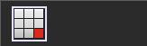 | 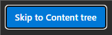 |
<!-- /shots:regions -->

### Tab stops
<!-- aid:tab-stops ef684bfc45 -->

**What it is for.** Tab in Sitecore stops on much you never act on: on the Desktop, a hidden frame Sitecore keeps
for its dialogs (a screen reader calls it "Dialog"); in the Content Editor, the splitter between the tree and the
editor, the tree's gutter icons, the label of every checkbox (so each checkbox takes two stops), the arrow beside
every drop-down, and ten header buttons and Quick Info boxes between the Content tab and the first field.

**What changes.** Nothing you can see, and the mouse works as before. Those stops leave the Tab order: the dialog
frame while no dialog shows, the splitter, the gutter, links in a field's label (a checkbox's label, and the links
add-ons put there), and a drop-down's arrow, since Down on the drop-down already opens it. Each field is one stop,
described by its label and help. Enter on the editor's selected tab (Content) moves to the item's first field;
Shift+Tab goes back through the header.

**How to use it.** From the tree, Tab once to the Content tab and press Enter; then Tab from field to field.

<!-- shots:tab-stops -->
**Need:** Keyboard and Screen reader · **On:** with the Keyboard and Screen reader needs, or on its own under Fine-tune · **Where:** the Desktop and Content Editor

**Off**

```text
the splitter: a Tab stop
the label "Enable Item Fallback": a Tab stop
the label "Enforce Version Presence": a Tab stop
a drop-down's arrow: a Tab stop
a drop-down's arrow: a Tab stop
```

**On**

```text
the splitter: no Tab stop
the label "Enable Item Fallback": no Tab stop
the label "Enforce Version Presence": no Tab stop
a drop-down's arrow: no Tab stop
a drop-down's arrow: no Tab stop
```
<!-- /shots:tab-stops -->

### Bigger targets
<!-- aid:targets f0b9bb97fe -->

**What it is for.** Sitecore's tree expanders, section arrows, drop-down arrows and window buttons are 14 to 16
pixels, hard to hit with a tremor or with low vision (WCAG 2.5.8 asks for 24).

**What changes.** Nothing moves and nothing looks different: a click on bare background within 5 pixels of one of
those icons goes to the icon, so its target is 24 pixels or more. A click on anything that takes clicks of its own,
such as an item's name beside its expander, stays where it landed.

<!-- shots:targets -->
**Need:** Keyboard and Low vision · **On:** with the Keyboard and Low vision needs, or on its own under Fine-tune · **Where:** the Desktop and Content Editor

_Bigger targets changes where a click lands, which a still picture cannot show: nothing on screen moves or looks different. Click just left of or below a tree expander, and the item expands._
<!-- /shots:targets -->

## Low vision

### High Contrast
<!-- aid:forced-colors f09069ecb5 -->

**What it is for.** With Windows High Contrast (forced colours) on, the browser repaints every colour from your
palette, which wipes out whatever Sitecore and the themes show by background alone: the selected tree item, the active
tab, the themes' drawn icons.

**What changes.** Under High Contrast only: selections and active tabs get the system highlight back, and the themes'
drawn glyphs keep their colours. Without High Contrast it does nothing.

<!-- shots:forced-colors -->
**Need:** Low vision · **On:** by default, under every theme and Native · **Where:** every page

**Off**

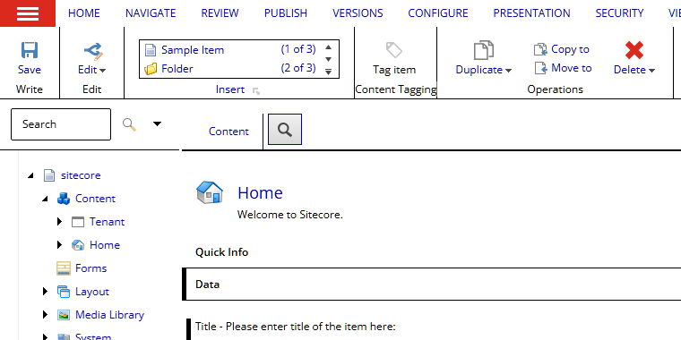

**On**

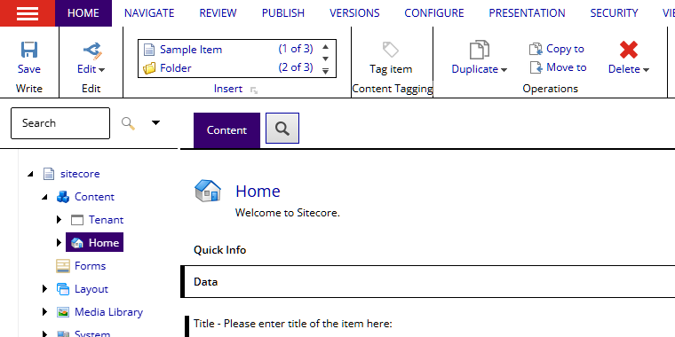
<!-- /shots:forced-colors -->

### Atkinson Hyperlegible

**What it is for.** A typeface drawn by the Braille Institute for low vision: letters that are easy to tell apart
(I, l and 1; O and 0).

**What changes.** Every Sitecore text in it, except code editors and icons. Picked for you when you tick Low vision,
unless you chose another font. Set under **Font**.

<!-- shots:font-hyperlegible -->
**Off**


**On**

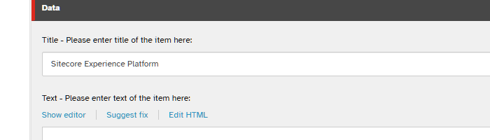
<!-- /shots:font-hyperlegible -->

## Colour vision

### Errors in words
<!-- aid:not-just-colour e5d7fd0f2f -->

**What it is for.** Sitecore shows a field's validation as a red or yellow bar beside it and nothing else, which
tells someone who cannot tell red from yellow nothing (WCAG 1.4.1).

**What changes.** The field's label starts with "Error:" or "Warning:" in bold while Sitecore shows the bar.

<!-- shots:not-just-colour -->
**Need:** Colour vision · **On:** with the Colour vision need, or on its own under Fine-tune · **Where:** the Desktop and Content Editor

**Off**

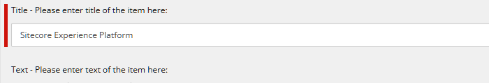

**On**

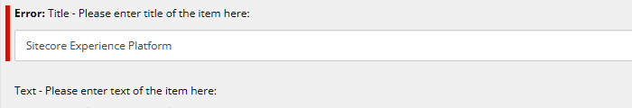

_The field is marked as Sitecore marks one that fails validation._
<!-- /shots:not-just-colour -->

### Errors in shapes
<!-- aid:state-shapes d858d42a2c -->

**What it is for.** Sitecore tells a field's validation by colour alone: a red or yellow bar beside the field, and red,
yellow, green and grey squares on the Validator Bar and in the validation dialog. Errors in words names the state on
the label; this gives every state a shape too, wherever Sitecore shows one (WCAG 1.4.1).

**What changes.**

- The bar beside a field is a column of crosses for an error and a wave for a warning. Every bar is 14px wide, so a
  field does not move when it validates.
- The field's control has a solid outline for an error and a dashed one for a warning.
- The label is bold, after a triangle for an error or a dotted ring for a warning. With Errors in words on too, the
  words follow the glyph.
- The Validator Bar's and the validation dialog's squares become a triangle (an error), a dotted ring (a warning), a
  tick (valid) and a plain ring (not validated yet).
- Message bars get a solid left edge for an error and a dashed one for a warning.

The colours start from the theme's error and warning markers, at the hue and strength of the section badges' red and
amber (so a thin cross or wave does not read as maroon or olive), and stay 3:1 or more on the field area under every
theme; under Native, Sitecore's red, and its amber darkened towards orange to reach the same.

<!-- shots:state-shapes -->
**Need:** Colour vision · **On:** with the Colour vision need, or on its own under Fine-tune · **Where:** the Desktop and Content Editor

**Off**

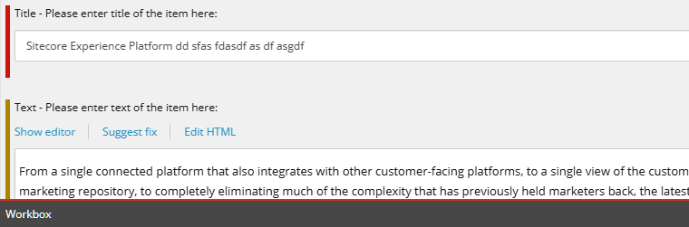

**On**

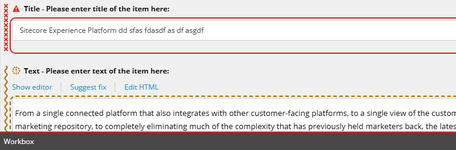

_Title marked as Sitecore marks an error, Text as it marks a warning._
<!-- /shots:state-shapes -->

### Colour filter

**What it is for.** For protanopia, deuteranopia and tritanopia: colours that run together for you (the green of a
publishable item, the red of an error) are moved apart.

**What changes.** A colour correction (daltonization) over the whole page, at a strength from 1 to 100. Set under
**Colour filter**.

<!-- shots:vision -->
**Off**

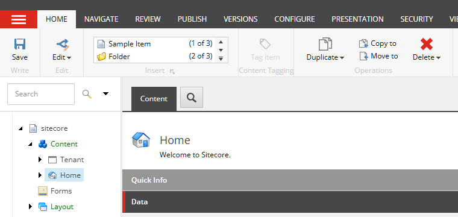

**On**

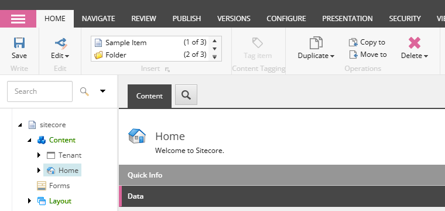

_Deuteranopia at full strength. To someone without the deficiency the picture looks shifted; to someone with it, colours that ran together come apart._
<!-- /shots:vision -->

## Reading and focus

### Focus mode
<!-- aid:focus-mode d9425fc1fa -->

**What it is for.** A long Content Editor form is a wall of fields; with attention or reading difficulties the one
you are editing gets lost in it.

**What changes.** While a field has focus (a rich text field's frame too), the other fields, the section captions,
the content tree and the ribbon fade back. Nothing moves or hides, and clicking a faded field works as before.

<!-- shots:focus-mode -->
**Need:** Reading and focus · **On:** with the Reading and focus need, or on its own under Fine-tune · **Where:** the Desktop and Content Editor

**Off**

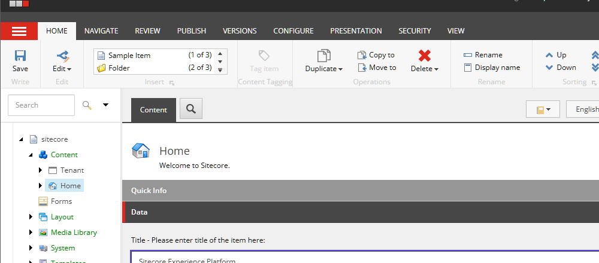

**On**

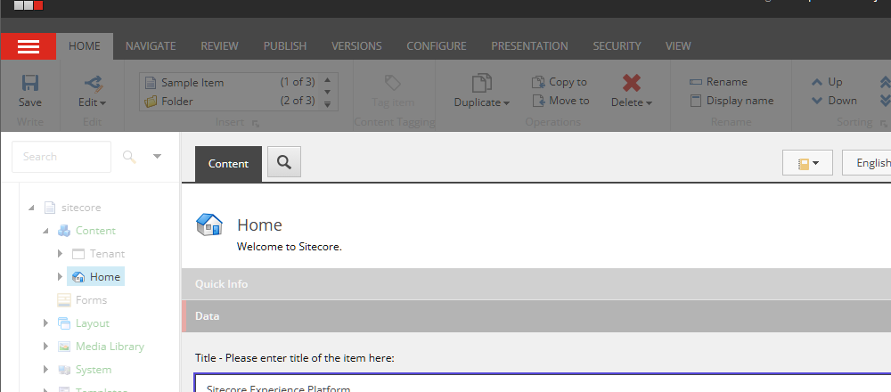
<!-- /shots:focus-mode -->

### Reading guide
<!-- aid:reading-guide a58c02b05b -->

**What it is for.** Keeping your place on a line, with dyslexia or attention difficulties: like holding a ruler
under the line you are reading, so your eye does not slip to the line above or below in a long list of fields or
a wide table.

**What changes.** A soft band across the page on the line you are reading: the line under the pointer, or the
element with keyboard focus. It never takes a click. One band shows at a time: in a page made of frames (the
Desktop's windows, the Content Editor's panes) only the frame the pointer or focus is in draws it.

<!-- shots:reading-guide -->
**Need:** Reading and focus · **On:** with the Reading and focus need, or on its own under Fine-tune · **Where:** the Desktop and Content Editor, SPEAK apps, the Launchpad, /sitecore/admin and the login pages

**Off**

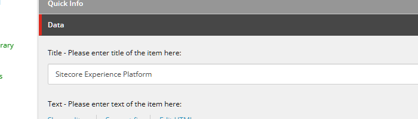

**On**

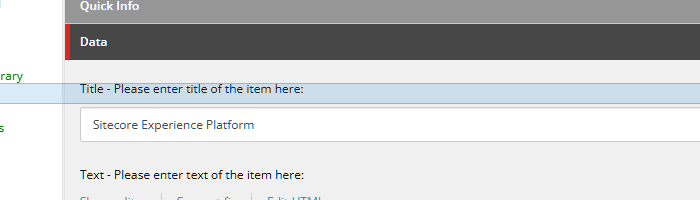
<!-- /shots:reading-guide -->

### OpenDyslexic

**What it is for.** A typeface with heavier bottoms to its letters, which some readers with dyslexia find steadier.

**What changes.** Every Sitecore text in it, except code editors and icons. Picked for you, with wide spacing, when
you tick Reading and focus, unless you chose another font. Set under **Font**.

<!-- shots:font-opendyslexic -->
**Off**

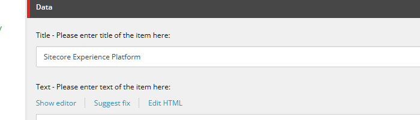

**On**

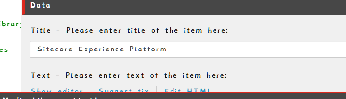
<!-- /shots:font-opendyslexic -->

### Wide spacing

**What it is for.** More room between letters and words helps some readers with dyslexia and low vision (WCAG 1.4.12).

**What changes.** Letter spacing of 0.06em and word spacing of 0.16em on every Sitecore text, except code editors
(PowerShell ISE, its results and the PowerShell Console) and icons. Set under **Spacing**.

<!-- shots:spacing -->
**Off**


**On**

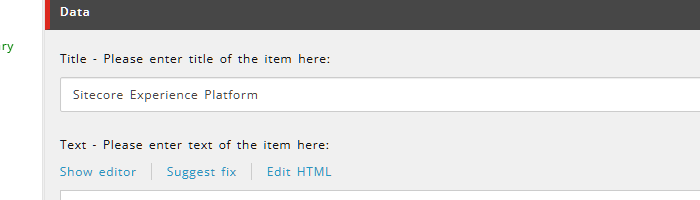
<!-- /shots:spacing -->

## Motion

### Reduced motion
<!-- aid:reduced-motion 1055d7d348 -->

**What it is for.** Sliding panels and animated transitions can trigger vestibular symptoms, migraine or seizures.

**What changes.** Sitecore's and the theme's CSS animations and transitions end at once, in their final state.
Sitecore's few script-driven slides are out of an extension's reach.

<!-- shots:reduced-motion -->
**Need:** Motion · **On:** with the Motion need, or on its own under Fine-tune · **Where:** every page

_Motion does not show in a still picture: with the aid on, Sitecore's and the theme's animations and transitions jump straight to their end._
<!-- /shots:reduced-motion -->

## Keeping this page current

Each aid's section carries a stamp of its code (`<!-- aid:<id> <hash> -->`), and `npm test` fails when an aid changed
since its section was last shot. After changing an aid, read its section again, then run
`node tools/aid-docs.cjs <id>` to shoot it off and on in the live 10.4 Content Editor and stamp it
(`--stamp <id>` stamps without shooting, for a change nothing on screen shows). A new aid needs a section here and a
scene in `tools/aid-docs.cjs`.
