# UI improvements

Themes for Sitecore carries a set of improvements to the Sitecore Content Management UIs that help anyone, whatever
their needs: buttons and information Sitecore lacks, a preview you can size, the Content Editor and the Experience
Editor opening where you left them, a command palette. Like the [accessibility aids](accessibility.md), they work
under every theme, change nothing on the server, and are undone the moment they are switched off.

This page describes every improvement: what it is for and what changes. Each has a picture of the Sitecore 10.4
Content Editor in its own look (Native) with it off and on, where there is something to see.

## Switching them on

Open the extension's popup, then **Settings** and the **UI improvements** tab (with the Sitecore module, its theme
picker has the same section). Each improvement has its own switch, grouped as on this page. They are all on by default
on every site, under every theme and Native; switch off the ones you do not want. **Reset to defaults** takes your
choices back.

Every setting is per site, and each browser keeps its own.

## Contents

- [In the Content Editor](#in-the-content-editor): [Image preview](#image-preview), [Section errors and warnings](#section-errors-and-warnings), [Locked fields](#locked-fields), [Back, forward, expand and collapse](#back-forward-expand-and-collapse), [Item info](#item-info), [Where am I](#where-am-i), [Sticky item header](#sticky-item-header), [Content tab first](#content-tab-first), [Quiet ribbon](#quiet-ribbon), [Type to search](#type-to-search)
- [Back where you left off](#back-where-you-left-off): [Remember Content Editor state](#remember-content-editor-state), [Remember Experience Editor state](#remember-experience-editor-state)
- [Keys](#keys): [Command palette](#command-palette), [Shortcuts help](#shortcuts-help)

## In the Content Editor

### Image preview
<!-- aid:image-preview 6671d3cf23 -->

**What it is for.** An Image field shows its image as a thumbnail at most 128px tall, whatever the image, so a wide
banner shows as a strip and the detail of a photo cannot be made out without opening it in the Media Library.

**What changes.** The preview's bottom-right corner gets a handle: drag it to make the preview taller or shorter, down
to 32px. Three buttons on the right of the line under the preview choose how the image sits in it. Normal shows it as
Sitecore does, the thumbnail at its own size in the top-left corner. Fill covers the whole preview with it, cropping
what sticks out. Fit shows the whole image as large as the preview allows, centred in it. For Fill and Fit the image comes from
Sitecore's media handler as tall as the preview needs on your display, so a large preview is sharp. Clicking the image
opens the media browser, as clicking round it always did; pressing or dragging the handle does not. The height and the choice
apply to every Image field, wherever Sitecore draws one: the Content Editor, the field editor and dialogs such as
PowerShell Extensions' Read-Variable with its image editor. They live in the site's own localStorage, so each browser
remembers its own. A screen reader
hears the buttons as a group named "Image preview size", each pressed or not. The handle is for the mouse only.

<!-- shots:image-preview -->
**On:** by default, under every theme and Native · **Where:** the Desktop and Content Editor

**Off**

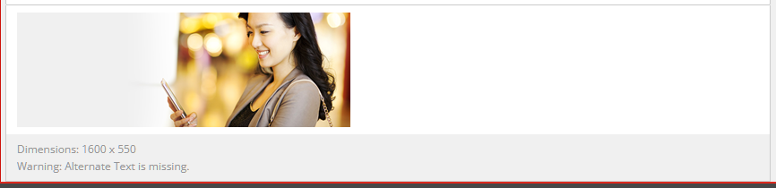

**On**

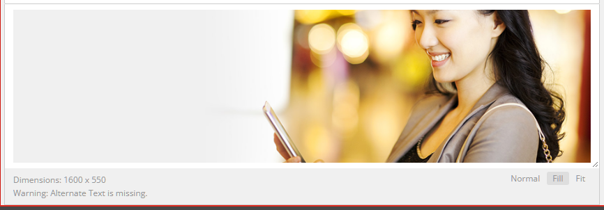

_On, the preview dragged to 220px and set to Fill._
<!-- /shots:image-preview -->

### Section errors and warnings
<!-- aid:section-issues adde08cef8 -->

**What it is for.** Sitecore marks a field that fails validation with a red or yellow bar beside it, and nothing else.
In a collapsed section, or one scrolled out of view, the bar cannot be seen, so a problem waits there until the item
is saved or sent through workflow.

**What changes.** Each section's title bar says on its right how many of its fields have errors and how many have
warnings ("1 error", "2 warnings"), in a red and an amber badge, in words so the state does not hang on the colour. A
collapsed section counts too. The counts follow Sitecore's own markers, so they change each time Sitecore validates,
as you leave a field. Each badge is a button: pressing it opens the section if it is closed and goes to the first field
with an error (or a warning), and to the next one on each press after. Hovering it shows Sitecore's messages, and a
screen reader hears the counts with the section's toggle. A section with nothing to report shows nothing. It works wherever Sitecore draws its sections: the
Content Editor and the field editor dialogs.

<!-- shots:section-issues -->
**On:** by default on every site that shows a theme · **Where:** the Desktop and Content Editor

**Off**

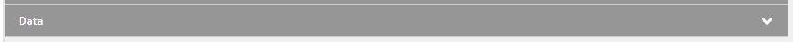

**On**

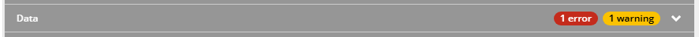

_The Data section closed, its Title typed past its Max Length 40 rule._
<!-- /shots:section-issues -->

### Locked fields
<!-- aid:locked-fields d353f52d68 -->

**What it is for.** On an item someone else has locked, one you have no write access to, or a protected one, Sitecore
shows a warning over the fields and makes them read-only, but a read-only field looks almost like one you can edit,
a shade greyer, so you find out when typing does nothing.

**What changes.** A Single-Line or Multi-Line Text field you cannot edit has a padlock on its right and a faint
diagonal hatch, and the warning over a locked item the same hatch. The hatch is drawn in the field's own text colour
and the padlock in a mid grey, so both show under light and dark themes.

<!-- shots:locked-fields -->
**On:** by default on every site that shows a theme · **Where:** the Desktop and Content Editor

**Off**

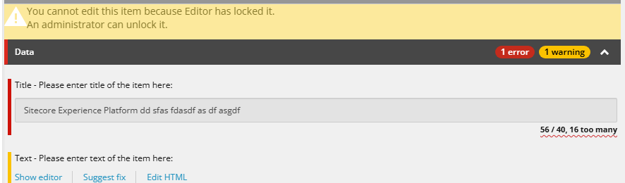

**On**

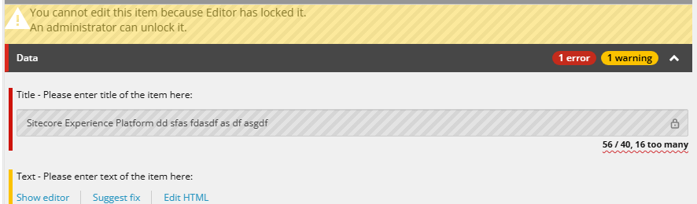

_Home drawn as Sitecore draws an item someone else has locked._
<!-- /shots:locked-fields -->

### Back, forward, expand and collapse
<!-- aid:section-toggle 3e4c3dccae -->

**What it is for.** Going back to the item you had open before takes the ribbon's Navigate tab, then Back. An item's
fields come in sections, and Sitecore opens or closes them one caption at a time, so reaching a field in a closed
section, or getting a long item down to its captions, takes a click per section.

**What changes.** Four buttons in the editor's tab bar, left of the section navigator. Back (a chevron pointing left)
and Forward (pointing right) do what Navigate > Back and Forward do on the ribbon, through Sitecore's own history of
the items you opened. Expand all sections (two chevrons pointing apart) opens every section, Collapse all sections
(two chevrons pointing together) closes them; they click Sitecore's own captions, so Sitecore remembers each section
open or closed as it does for a single click. A button with nothing to do is greyed out: Back and Forward whenever the
ribbon's are, Expand all when every section is open and Collapse all when every one is closed. The four buttons and
the navigator beside them are drawn flat, with no frame, and shaded while the pointer is on one. A screen reader hears
each button's name, and that a greyed-out one is unavailable.

<!-- shots:section-toggle -->
**On:** by default on every site that shows a theme · **Where:** the Desktop and Content Editor

**Off**

**On**

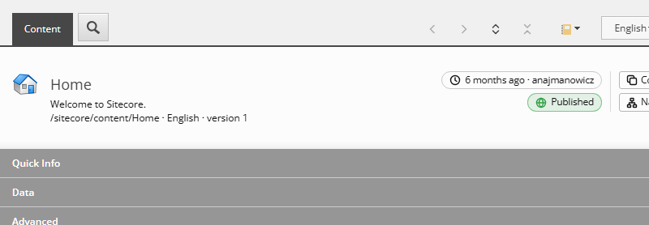
<!-- /shots:section-toggle -->

### Item info
<!-- aid:item-info b3014e5dd1 -->

**What it is for.** When an item was last changed, by whom, and whether it is live are spread over the Statistics
section (hidden with the standard fields), the version menu and the web database. Copying an item's ID or opening the
templates it inherits from takes several clicks and a search.

**What changes.** A small panel at the right of the item's header. Its top pill says how long ago the version you are
editing was modified and by whom ("2 hours ago · jsmith"); its tooltip has the full date and the user's domain. The
pill below compares the web database with what the next publish would put there in this language: master's newest
version that its publishing settings let go live. "Published · v3" means that version is live. An item that cannot go
live and has nothing in web gets one grey pill: "Never publishes" (its Publishable box unticked), "Publishes from 12
Nov", "Not publishable" or "Not for web" (its publishing targets leave out Internet). Otherwise the pill splits in two:
its left half says what is live ("Live v2", or "Not published"), its right half the one thing to know next, most
serious first. In red, "comes down on next publish" or "back to v1 on next publish" when the item or the live version
can no longer be published, and "not in master" when web holds a version master no longer has. In grey, when settings
hold back the newest version on purpose: "v3 not publishable", "v3 from 12 Nov", or "until 30 Nov" while the item's
or version's end date is ahead. In blue, "v3 · Awaiting Approval" when the version that would go live is still in
workflow; in amber, "v3 ready to publish" when it is in a final state or the item has no workflow, and "edited since"
when the live version was changed after it was published. A screen reader hears both halves, and the tooltip says
each in a sentence, with anything the pill had no room for. The settings come from the item's Publishing Settings
dialog, read without opening it; the workflow state from the Review tab's workflow menu, where a state with no
workflow commands, such as Sample Workflow's Approved, counts as final.
**Copy** opens a menu of the item's and its template's name, path and ID; picking one copies it. **Navigate** opens a
menu of the item's template and the templates it inherits from, nested, with Sitecore's own (under
/sitecore/templates/System) left out; picking one opens it in the Content Editor.

The panel never holds up the editor: the pills fill in once the browser is idle, from the version list Sitecore shows
under the version button, the publishing settings (and the workflow menu, only when web lacks the version that would
go live), and Navigate asks for the
template's inheritance only when it opens. Copy reads Quick Info, already in the page; with Quick Info switched off
there is no template to copy or open, so Navigate is left out.

Both buttons are menu buttons: Enter, Space or Down opens the menu with focus on its first entry, the arrows, Home and
End move, and Escape closes it with focus back on its button. A screen reader hears "Copied" after a copy.

<!-- shots:item-info -->
**On:** by default, under every theme and Native · **Where:** the Desktop and Content Editor

**Off**

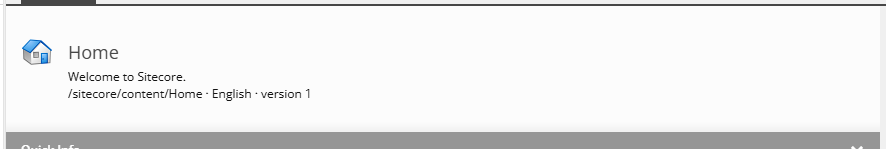

**On**

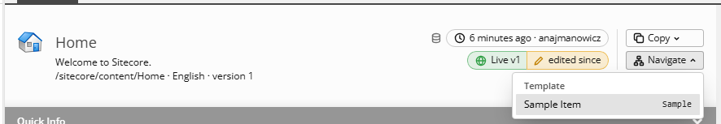
<!-- /shots:item-info -->

### Where am I
<!-- aid:where-am-i d9d0c4f445 -->

**What it is for.** The Content Editor's header shows only the item's name. Its path, and which language and version
you are editing, are elsewhere or hidden in Quick Info.

**What changes.** One line under the item's name: its path, language and version ("/sitecore/content/Home · English ·
version 1"), in the header's own help style.

<!-- shots:where-am-i -->
**On:** by default, under every theme and Native · **Where:** the Desktop and Content Editor

**Off**

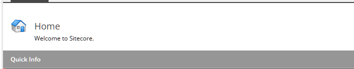

**On**

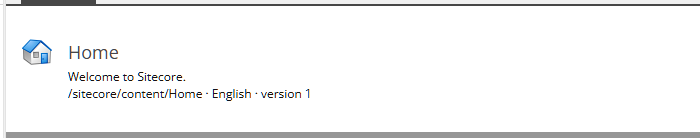
<!-- /shots:where-am-i -->

### Sticky item header
<!-- aid:sticky-header c524188a8a -->

**What it is for.** On a long item the header with the item's name and icon scrolls away with the first section, and
with it the answer to "which item am I editing?".

**What changes.** The header stays at the top of the editor while the fields scroll under it, across the editor's
whole width. Its last few pixels
fade to see-through, so a field slides under it rather than being cut off by a hard edge. The rest of it is
frosted: the fields under it show only as a faint blur, under the colour the header has in the theme (where a theme
draws it clear or as glass, the panel's colour behind it), kept in step with the theme and the light or dark setting.
The warnings and the Quick Info section below it scroll as before.

<!-- shots:sticky-header -->
**On:** by default, under every theme and Native · **Where:** the Desktop and Content Editor

**Off**

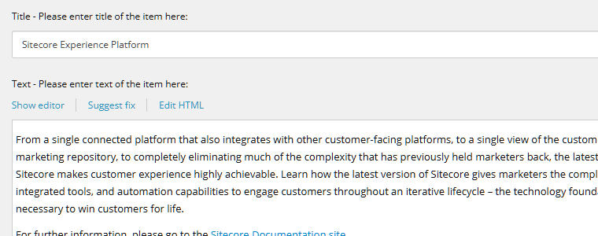

**On**

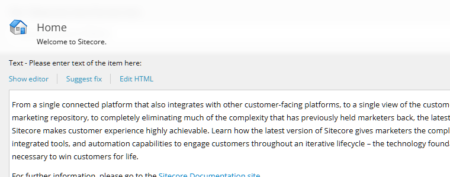
<!-- /shots:sticky-header -->

### Content tab first
<!-- aid:content-tab 40a832b425 -->

**What it is for.** An item whose template gives it an editor of its own (a folder's Folder tab, a bucket's search,
a media folder's thumbnails) opens on that tab, so editing its fields takes an extra click every time.

**What changes.** Every item opens on its Content tab. It switches once, as the item loads: a tab you pick afterwards
stays picked until you open another item. This includes the Media Library, whose folders then open on their fields
rather than their thumbnails.

<!-- shots:content-tab -->
**On:** by default, under every theme and Native · **Where:** the Desktop and Content Editor

**Off**

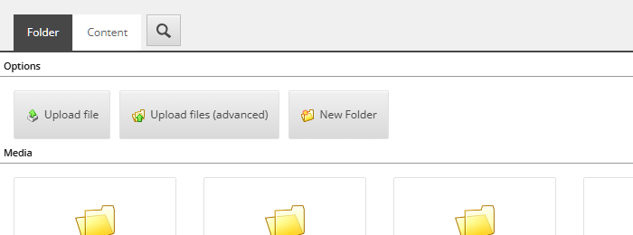

**On**

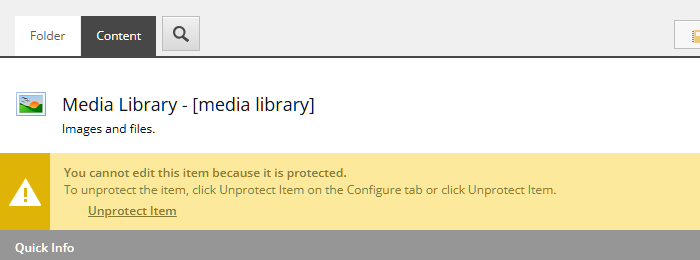
<!-- /shots:content-tab -->

### Quiet ribbon
<!-- aid:quiet-ribbon 5e12199889 -->

**What it is for.** The ribbon shows dozens of commands you may never use. Fewer on screen means less to scan.

**What changes.** Each ribbon group gets a small × in its corner, shown on hover or focus; it hides that group. A strip
with hidden groups ends with a slim button as tall as a group, "»" over the number hidden, which shows them all again.
It never makes the ribbon taller. Hidden groups stay in the page (the command palette still finds their commands) and
the choice is kept per site, in this browser.

**How to use it.** Point at a group and click its ×, or Tab to it and press Enter. Click the » button to bring them
back.

**What a screen reader says.** "Hide the Sorting group, button" on each ×, and "Show 3 hidden groups, button" on the »
button.

<!-- shots:quiet-ribbon -->
**On:** by default, under every theme and Native · **Where:** the Desktop and Content Editor

**Off**

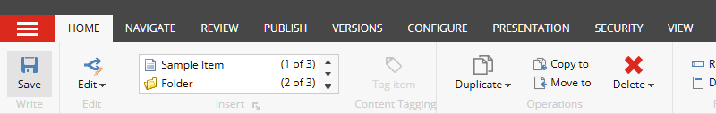

**On**

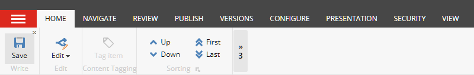
<!-- /shots:quiet-ribbon -->

### Type to search
<!-- aid:tree-keys c8bc01baa8 -->

**What it is for.** Finding an item in a long tree with the arrows alone is slow, and Sitecore's search box leaves
the tree. An item with dozens of fields has the same problem in the editor: finding one field means scrolling past
the rest.

**What changes.** Typing searches the part of the Content Editor you are in and narrows it to what matches. A small
panel shows what you typed and how many match.

- **In the content tree** (a tree item has focus, or you last clicked anywhere in the tree): it searches the items
  the tree has loaded, by name and by template name ("sample" finds every Sample Item). Matching items stay, with the
  items above them faded as their path; the rest hide. Focus goes to the nearest match, and its template shows in
  the panel.
- **In the editor** (you last clicked in it, or its tabs have focus): it searches the fields by their labels and by
  their types ("rich" finds every Rich Text field, "droplink" every Droplink). A section with a match stays, opened
  if it was closed, showing only its matching fields; sections without one hide. The match is outlined, and its name
  and type show in the panel.
- Sitecore's own dialogs tell it the templates and the types (Change Template, the Template Builder and the
  Inheritance tab), asked when a search starts; the matches by template or type join the others a moment later.
  A user who cannot open those dialogs searches by name only.
- The letters typed match in that order, not only side by side: "qagk" finds QA Automated GreeneKing, "vid" finds
  VenueId.
- Typing in a field, a box or a rich text editor types there, as always.

**How to use it.** Click in the tree or in the editor (an empty spot will do), then type.

- More letters narrow the search; Backspace or Delete take the last one off (Delete does not delete the tree item
  while you search).
- Tab or Down moves to the next match, Shift+Tab or Up to the previous one.
- Enter picks the match: everything shows again, with the match in the middle of the view. A tree item opens, as
  Enter always does; in the editor the cursor goes into the field (in a rich text field, its editor box), and a
  section that was closed opens as it does when you click it, so it stays open for you next time.
- Clicking an item in the narrowed tree opens it, as Enter does.
- Escape puts everything back as it was, closed sections closed; Left, Right or a click elsewhere do too.
- The tree search covers the items the tree has loaded: open a node to search inside it.

**What a screen reader says.** Each tree match as focus lands on it; for fields, which focus does not move to, the
panel says the field shown, its type and the count ("Title · Single-Line Text · 1 of 3"); for a tree match it says
the item's template. "No match" when nothing matches.

<!-- shots:tree-keys -->
**On:** by default on every site that shows a theme · **Where:** the Desktop and Content Editor

| Off | On |
|---|---|
| 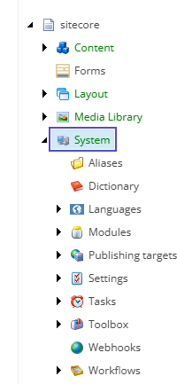 | 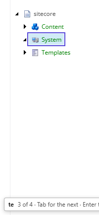 |
<!-- /shots:tree-keys -->

<!-- shots:field-search -->
**Off**

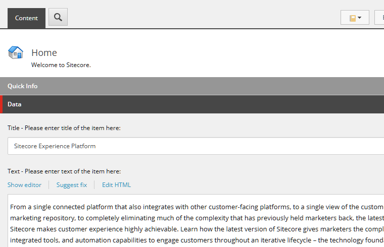

**On**

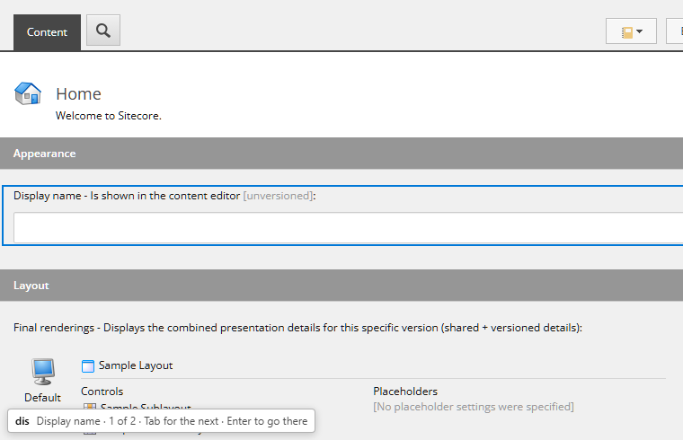
<!-- /shots:field-search -->

## Back where you left off

### Remember Content Editor state
<!-- aid:ce-state f5c7ac7901 -->

**What it is for.** Sitecore opens the Content Editor on Home every time, with Quick Info open, so getting back to
the item you were working on means finding it in the tree again, and closing Quick Info again if you keep it closed.

**What changes.** The Content Editor opened from the Launchpad or the Desktop's start menu goes on to the item you
last had open in it, in the language and version you left it in, and opens or closes Quick Info as you last left
it. An
editor opened on an item (from the Workbox, the Experience Editor or a link) stays on that item, and is remembered
in its turn. The Media Library and the small editors in dialogs are left alone. The item and Quick Info's state live
in the site's own localStorage, so each browser remembers its own.

<!-- shots:ce-state -->
**On:** by default, under every theme and Native · **Where:** the Desktop and Content Editor

_Remember Content Editor state changes where the Content Editor opens, which a still picture cannot show: close it on an item, open it again from the Launchpad or the Desktop, and it is back on that item._
<!-- /shots:ce-state -->

### Remember Experience Editor state
<!-- aid:ee-state c04c65f728 -->

**What it is for.** The Experience Editor opens on the site's start page every time, so getting back to the page you
were editing means navigating to it again.

**What changes.** The Experience Editor opened on the start page, from the Launchpad or a typed address, reloads once
on the page you last had open in it, in the language you had it in, for the same site. A page you reach inside it,
through a link or the ribbon's Navigate, stays where it is, and so does an editor opened on an item (the Content
Editor's Experience Editor button). The page lives in the site's own localStorage.

<!-- shots:ee-state -->
**On:** by default, under every theme and Native · **Where:** the Experience Editor

_Remember Experience Editor state changes which page the Experience Editor opens on, which a still picture cannot show: leave it on a page, open it again from the Launchpad, and it is back on that page._
<!-- /shots:ee-state -->

## Keys

### Command palette
<!-- aid:command-palette 4397f81292 -->

**What it is for.** Reaching a ribbon command with the keyboard means finding its tab and then its button; going to
an item means walking the tree.

**What changes.** Ctrl+Shift+Space opens a palette of every ribbon command on the page, those on other tabs too, by
name and group ("Publish item · Publish"); one on another tab opens that tab, then runs. Typing an item path (`/sitecore/content/Home`) or ID (`{110D...}`)
offers to go to it, opening it in the editor and selecting it in the tree, with no search left open.

**How to use it.** Ctrl+Shift+Space, type a few letters, Up and Down to pick, Enter to run, Escape to close.

**What a screen reader says.** A combo box with a list of commands; the highlighted one as you move.

<!-- shots:command-palette -->
**On:** by default, under every theme and Native · **Where:** the Desktop and Content Editor, SPEAK apps and the Launchpad

**Off**

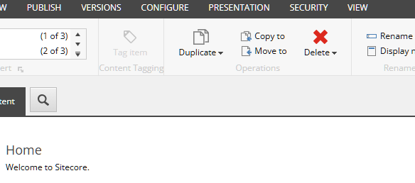

**On**

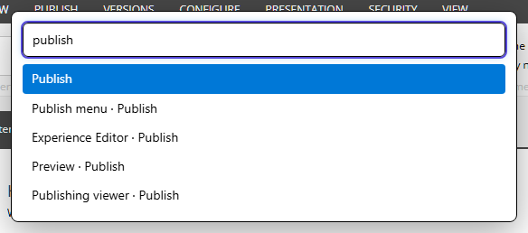
<!-- /shots:command-palette -->

### Shortcuts help
<!-- aid:shortcuts-help 03b7cc8ea0 -->

**What it is for.** Sitecore's keyboard shortcuts are spread across tooltips and access keys, the aids and
improvements add their own, and nothing on the page says which of them are on.

**What changes.** F1 (or Ctrl+/) opens a cheat sheet for the frame you are in: Sitecore's shortcuts (from its ribbon's
access keys and key hints), the shortcuts of the aids and improvements running there, and every one of them and every
reading setting that is on,
each with a line on what it does. Plain F1 no longer opens the browser's help on these pages; Alt+F1 stays Sitecore's.

**How to use it.** F1 or Ctrl+/; Escape or Close to leave. In SPE's script editor Ctrl+/ comments a line, so use F1
there.

<!-- shots:shortcuts-help -->
**On:** by default, under every theme and Native · **Where:** the Desktop and Content Editor, SPEAK apps, the Launchpad and /sitecore/admin

**Off**

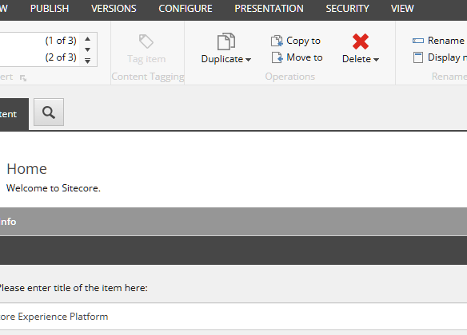

**On**

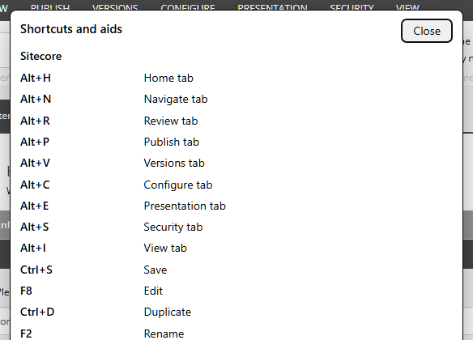
<!-- /shots:shortcuts-help -->

## Keeping this page current

Each improvement's section carries a stamp of its code (`<!-- aid:<id> <hash> -->`), and `npm test` fails when one
changed since its section was last shot. After changing one, read its section again, then run
`node tools/aid-docs.cjs <id>` to shoot it off and on in the live 10.4 Content Editor and stamp it (`--stamp <id>`
stamps without shooting, for a change nothing on screen shows). A new improvement needs a section here and a scene in
`tools/aid-docs.cjs`.
